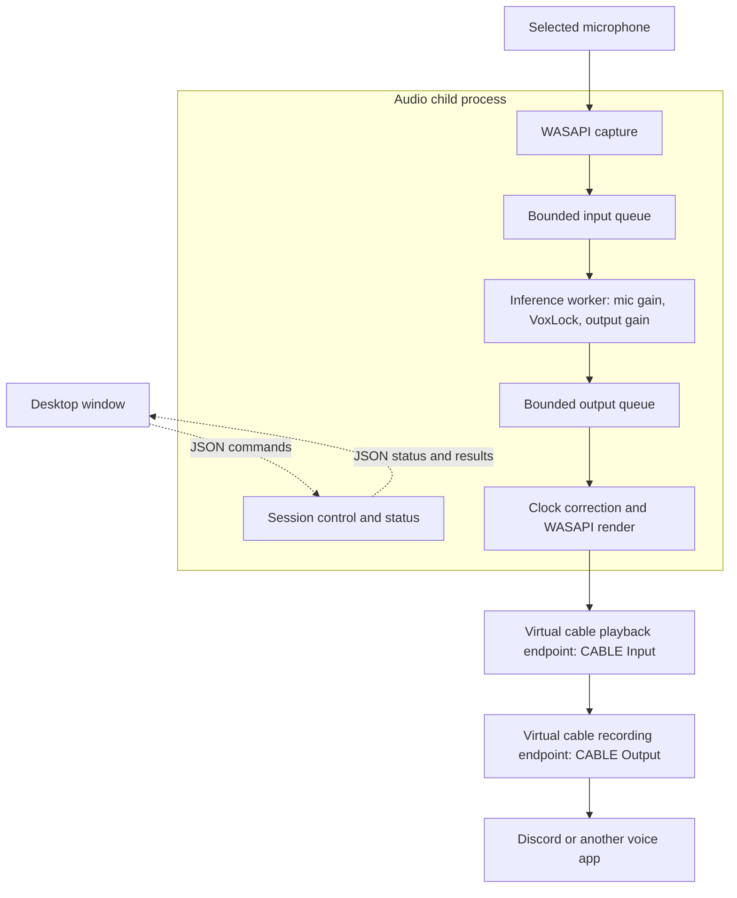
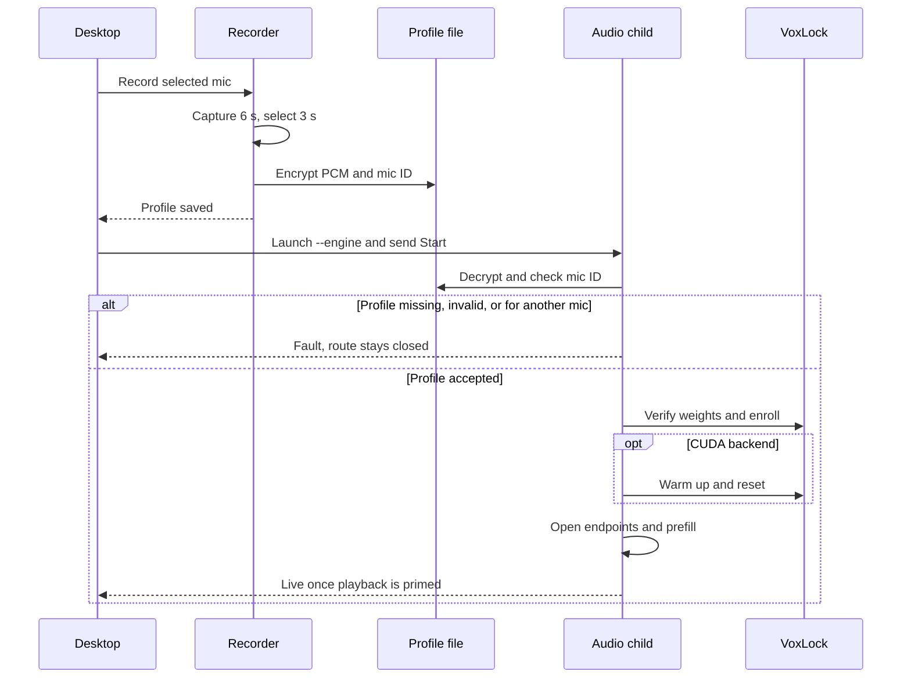

# VoiceIsolator architecture

VoiceIsolator takes audio from a Windows microphone, uses a recording of the intended speaker to condition a streaming VoxLock model, and sends isolated audio to a virtual cable. The Windows desktop configures and monitors that route. The developer WAV harness uses the same model adapter with file input and output.

## Live audio path

Solid arrows carry audio. Dotted arrows carry control or status; the desktop does not receive live PCM over the pipes. The virtual cable endpoint names shown are for VB-CABLE: VoiceIsolator writes to **CABLE Input**, while the downstream app reads from **CABLE Output**.

- [WASAPI](../rust/wasapi.rs) opens event-driven shared-mode streams in mono 16 kHz float PCM and asks Windows to handle device format conversion. Capture and render share one audio I/O thread. [The inference worker](../rust/engine.rs) reads full batches from a single-producer, single-consumer ring, ramps mic gain, calls VoxLock, ramps output gain, and publishes any samples the model emits. Live batch sizes are 16, 24, 32, or 40 ms; the model's internal hop is 128 samples (8 ms).
- [Playback](../rust/playback.rs) uses a second ring for processed samples. Each ring has an 80 ms audio budget, with extra history space for band-limited interpolation on the output ring. Playback starts with silence and waits for a software prefill of at least 34 ms; the actual threshold also accounts for the capture period, batch size, render target, and interpolation lookahead. The WASAPI render target is two shared periods, capped by the endpoint's capacity.
- The microphone and cable have independent clocks. Playback tracks queue depth and slightly adjusts its rate, using linear interpolation by default or band-limited sinc when selected. If a refill runs short, playback zero-fills the remainder, counts an underrun, and waits for prefill again. It never substitutes raw mic audio.

## Enrollment and session startup

[The desktop](../rust/desktop.rs) records enrollment on a background thread. It selects the three-second window with the most active 20 ms bins and rejects recordings with too little activity or too much clipping. [Preferences](../rust/preferences.rs) saves the selected PCM and mic ID to `%LOCALAPPDATA%\VoiceIsolator\voice-profile.dat`, encrypted with Windows DPAPI for the current user. Endpoint selections and the theme are stored separately under `HKCU\Software\VoiceIsolator`. The live child reloads the profile from disk; the startup message carries configuration and endpoint IDs.

[The VoxLock adapter](../rust/isolation.rs) verifies the selected ONNX files against their pinned SHA-256 hashes and creates a sherpa-onnx streaming denoiser. It supplies enrollment PCM directly to the C API and strips the 128-sample enrollment probe from returned audio. Live CPU uses `enroll.onnx` with `chunk_int8.onnx`; live CUDA uses `enroll.onnx` with `chunk.onnx`. If model setup or CUDA warm-up fails, the child reports the fault before opening the audio route.

## Session changes and recovery

[`Session`](../rust/engine.rs) launches the same executable with `--engine` and supervises it through newline-delimited JSON on stdin and stdout. Gain changes update the running worker. Changing the cable, backend, batch size, CPU threads, or clock correction stops the old child before launching a replacement. Changing the microphone or enrolling again requires stopping isolation.

Within the child, capture gaps, endpoint failures, or queue overflow can end an attempt to run the route. The inference worker gives render up to 20 ms to free space before treating a full output queue as a fault. Recovery discards both queues, resets the model stream, and reopens the selected endpoints; repeated failures stop the route. If the child stops making progress, the desktop watchdog can end the process. A Windows Job Object also ties the child to the desktop's lifetime.

## Latency measurement

[The latency probe](../rust/latency.rs) temporarily samples timestamped microphone packets before inference and captures the matching VB-CABLE recording endpoint. It correlates about six seconds of audio, excluding windows affected by interruptions. If waveforms do not match reliably, it tries the speech-level envelopes and marks a successful fallback as approximate. The result includes the median and 95th percentile delay plus the matched fraction of eligible windows. This measures the path through the virtual cable. Discord, the network, and headphone playback are outside the measurement.

For the source map and build or test entry points, see the [development guide](development.md).
