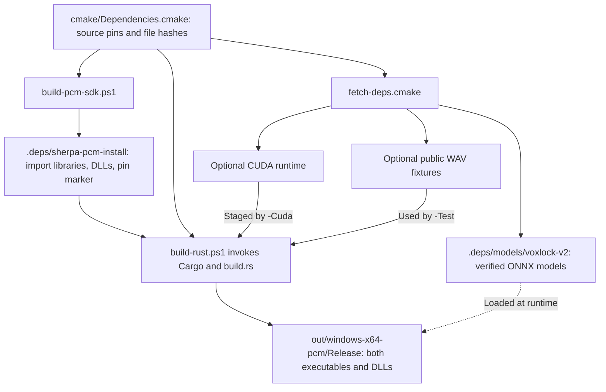

# Developing VoiceIsolator

Start with the [architecture guide](architecture.md) for the live audio path and process boundaries. Use this page to find the code, understand what the build prepares, and pick the right test for a change.

## Repository map

| If you are changing… | Start here |
| --- | --- |
| The desktop UI, device pickers, or enrollment controls | [`rust/desktop.rs`](../rust/desktop.rs), the `voiceisolator_live.exe` entry point |
| The child process, control messages, or live batch scheduling | [`rust/engine.rs`](../rust/engine.rs), reached through `voiceisolator_live.exe --engine` |
| Endpoint discovery, capture, render, or enrollment selection | [`rust/wasapi.rs`](../rust/wasapi.rs) |
| Queues, playback buffering, or clock correction | [`rust/playback.rs`](../rust/playback.rs) |
| Model loading, speaker conditioning, or streaming inference | [`rust/isolation.rs`](../rust/isolation.rs) and [`rust/cuda.rs`](../rust/cuda.rs) |
| Saved voice profiles or user preferences | [`rust/preferences.rs`](../rust/preferences.rs) |
| Live latency measurement | [`rust/latency.rs`](../rust/latency.rs) |
| Offline isolation, timing reports, or WAV handling | [`rust/cli.rs`](../rust/cli.rs), the `voiceisolator.exe` entry point, and [`rust/wav.rs`](../rust/wav.rs) |

[`Cargo.toml`](../Cargo.toml) declares both binaries and the shared library in [`rust/lib.rs`](../rust/lib.rs). The default `desktop` feature enables the egui application. The VoxLock source submodule is an upstream reference; the Rust build links the separately pinned sherpa-onnx SDK.

## Build and runtime dependencies

- [`cmake/Dependencies.cmake`](../cmake/Dependencies.cmake) pins the native SDK revision and downloaded assets. [`scripts/fetch-deps.cmake`](../scripts/fetch-deps.cmake) fetches and verifies models and optional assets. [`scripts/build-pcm-sdk.ps1`](../scripts/build-pcm-sdk.ps1) builds the pinned sherpa-onnx source and writes an SDK pin marker.
- [`build.rs`](../build.rs) requires Windows x64 MSVC, checks the SDK marker, passes model pins to the Rust compiler, and links the sherpa-onnx and ONNX Runtime import libraries. [`scripts/build-rust.ps1`](../scripts/build-rust.ps1) builds both binaries and puts their DLLs beside them. The `-Cuda` switch stages the CUDA-enabled ONNX Runtime package in the same output directory.
- The desktop first looks for a `models/` directory beside its executable. If that directory is absent, it looks in `.deps/models/voxlock-v2` under the build's source checkout. The CLI takes its model directory from `--models`. Models stay outside the executables and are verified when opened.

Follow the [README build commands](../README.md#open-the-desktop-app) for a fresh checkout and the [CUDA instructions](../README.md#enable-cuda) for GPU setup.

## Pick a check

| What you want to verify | How to verify it |
| --- | --- |
| Rust behavior and model integration | Once the PCM SDK is installed, run `cmake -DVOICEISOLATOR_TEST_FIXTURES=ON -P scripts/fetch-deps.cmake`, then `.\scripts\build-rust.ps1 -Test`. The script runs the standard Rust suite and the ignored library fixture tests. The [engine integration test](../tests/rust_engine.rs) verifies that missing enrollment reports a fault before any audio devices open. |
| Model output or worker timing | Use the [WAV harness](../README.md#developer-wav-harness). `isolate` reads separate enrollment and input WAVs, processes batches through the shared adapter, flushes the model to match input length, and writes a new WAV. `bench` reports processing times without writing audio; `--paced` simulates arrivals on a real-time cadence. WAV inputs must be mono 16 kHz PCM16. |
| Routing, audible stability, and cable latency | Use the live desktop with the actual mic and VB-CABLE. Check that enrollment, start and stop, and the downstream input work. Run the built-in latency measurement under the workload you care about. The WAV harness does not exercise WASAPI, the cable, or the live queues. |
| Speaker isolation quality and sustained performance | Follow [Phase 1 validation](phase-1-validation.md) for room recordings, listening, [`score-room.py`](../scripts/score-room.py), and the [`run-benchmark.ps1`](../scripts/run-benchmark.ps1) paced matrix. Keep recordings and reports in the ignored `recordings/` and `reports/` directories. |
